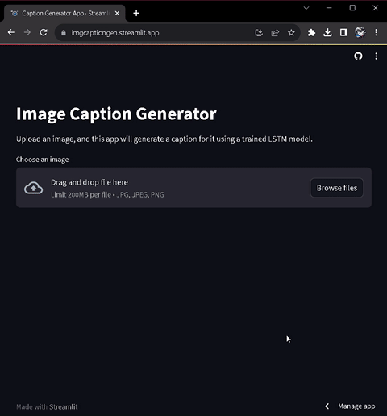

<div align="center">

# 📷 CaptionCraft-AI
### *Intelligent Deep Learning Image Caption Generator*

[](https://github.com/vishnukamatham/CaptionCraft-AI)
[](https://www.python.org/)
[](https://www.tensorflow.org/)
[](https://streamlit.io/)
[](LICENSE.md)

<p align="center">
  <b>CaptionCraft-AI</b> bridges computer vision and natural language processing to automatically generate meaningful, human-like descriptive captions for any input image in real time.
</p>

[Explore Demo](#-interactive-demo) •
[Key Features](#-key-features) •
[Architecture](#-system-architecture) •
[Quickstart](#-quickstart--installation) •
[Project Structure](#-project-structure) •
[Author](#-author)

</div>

---

## 🌟 Highlights

- 🧠 **Hybrid CNN-LSTM Pipeline**: Integrates convolutional feature extractors (`MobileNetV2` / `VGG16`) with a recurrent LSTM language decoder.
- ⚡ **Lightweight & Fast**: Powered by `MobileNetV2` feature representations for rapid inference and low memory consumption.
- 🎨 **Sleek Streamlit UI**: Intuitive web interface featuring seamless drag-and-drop uploads, interactive status feedback, and elegant typography.
- 📚 **Flickr8k Trained**: Pre-trained on thousands of multimodal image-caption pairs with specialized tokenization.
- 🛠️ **Production-Ready**: Includes pre-trained weights (`mymodel.h5`), serialized tokenizer (`tokenizer.pkl`), and modular inference scripts.

---

## 🎬 Interactive Demo



> *Upload any PNG or JPEG image and watch CaptionCraft-AI extract visual cues and construct contextual descriptions word-by-word.*

---

## 🏗️ System Architecture

CaptionCraft-AI employs an **Encoder-Decoder architecture** connecting spatial image embeddings to sequential language modeling:

```
                      ┌───────────────────────────┐
                      │        Input Image        │
                      └─────────────┬─────────────┘
                                    │ (224x224 RGB)
                                    ▼
                      ┌───────────────────────────┐
                      │    MobileNetV2 Encoder    │
                      │  (Pre-trained on ImageNet)│
                      └─────────────┬─────────────┘
                                    │ Dense Feature Vector (1280)
                                    ▼
   ┌──────────────────┐       ┌───────────┐
   │ Current Sequence │       │ Dense /   │
   │   Token IDs      │       │ Dropout   │
   └────────┬─────────┘       └─────┬─────┘
            │                       │
            ▼                       │
   ┌──────────────────┐             │
   │ Embedding + LSTM │             │
   └────────┬─────────┘             │
            │                       │
            └───────────┬───────────┘
                        ▼
             ┌─────────────────────┐
             │ Merge & Dense Layer │
             └──────────┬──────────┘
                        ▼
             ┌─────────────────────┐
             │  Softmax Vocabulary │
             │   Word Prediction   │
             └──────────┬──────────┘
                        ▼
             ┌─────────────────────┐
             │  Generated Caption  │
             └─────────────────────┘
```

### Inference Workflow
1. **Preprocessing**: The input image is resized to `224x224` and normalized via `preprocess_input`.
2. **Feature Extraction**: High-level semantic features are extracted using the penultimate layer of `MobileNetV2`.
3. **Sequential Decoding**: The model starts with the special `startseq` token, predicting one token at a time until reaching `endseq` or `max_caption_length = 34`.
4. **Post-Processing**: Tokens are converted back to words via `tokenizer.pkl` and formatted cleanly for user display.

---

## 💻 Tech Stack

| Domain | Technologies |
| :--- | :--- |
| **Language** | Python 3.10+ |
| **Deep Learning** | TensorFlow 2.15, Keras |
| **Computer Vision** | MobileNetV2, VGG16, Pillow |
| **Data Processing** | NumPy, Pandas, Pickle |
| **Web Interface** | Streamlit |
| **Exploration** | Jupyter Notebook |

---

## 🚀 Quickstart & Installation

### 1. Prerequisites
Ensure you have Python 3.10 or higher installed.

```bash
python --version
```

### 2. Clone the Repository
```bash
git clone https://github.com/vishnukamatham/CaptionCraft-AI.git
cd CaptionCraft-AI
```

### 3. Create and Activate Virtual Environment
- **Windows (PowerShell):**
  ```powershell
  python -m venv venv
  .\venv\Scripts\Activate.ps1
  ```
- **macOS / Linux:**
  ```bash
  python3 -m venv venv
  source venv/bin/activate
  ```

### 4. Install Dependencies
```bash
pip install --upgrade pip
pip install -r requirements.txt
```

---

## 🎯 Usage

### Running the Streamlit Web Application
Launch the interactive web app locally:
```bash
streamlit run app.py
```
Open your browser at `http://localhost:8501` to use the application.

### Training & Notebook Exploration
To explore the training pipeline, model evaluation, and dataset preprocessing:
```bash
jupyter notebook image-captioner.ipynb
```

---

## 📂 Project Structure

```text
CaptionCraft-AI/
├── resource/
│   └── demo.gif              # Animated demonstration of the web app
├── .gitignore                # Ignored cache, virtual envs, and temporary files
├── app.py                    # Streamlit web interface and inference pipeline
├── image-captioner.ipynb     # Complete training and evaluation Jupyter notebook
├── LICENSE.md                # MIT Open Source License
├── mymodel.h5                # Trained LSTM caption generator weights
├── README.md                 # Professional documentation & project overview
├── requirements.txt          # Python dependencies and locked package versions
└── tokenizer.pkl             # Word-to-index mapping dictionary
```

---

## 📊 Dataset Details

The model was trained on the benchmark **Flickr8k** dataset:
- **Total Images**: 8,091 real-world photographs.
- **Captions**: 5 distinct human-annotated captions per image (40,455 total captions).
- **Format**: Pairings of image filenames and textual descriptions.
- **Source**: Available on [Kaggle Flickr8k Dataset](https://www.kaggle.com/datasets/adityajn105/flickr8k).

To retrain from scratch:
1. Download the dataset from Kaggle.
2. Structure your directory as:
   ```text
   flickr8k/
   ├── Images/
   └── captions.txt
   ```
3. Update paths in `image-captioner.ipynb` and execute all cells.

---

## 🌐 Deployment Guide (Streamlit Cloud)

You can easily deploy **CaptionCraft-AI** on **Streamlit Community Cloud**:
1. Fork or push this repository to your GitHub account: `https://github.com/vishnukamatham/CaptionCraft-AI`.
2. Visit [share.streamlit.io](https://share.streamlit.io/) and log in with GitHub.
3. Click **"New app"** and select:
   - **Repository**: `vishnukamatham/CaptionCraft-AI`
   - **Branch**: `main`
   - **Main file path**: `app.py`
4. Click **Deploy!**

---

## 🗺️ Roadmap & Future Enhancements

- [ ] **Transformer Backbone**: Integrate Vision Transformers (ViT) or BLIP for next-generation captioning accuracy.
- [ ] **Beam Search Decoding**: Replace greedy search with beam search to generate multiple diverse caption candidates.
- [ ] **Text-to-Speech (TTS)**: Add natural audio narration of generated captions.
- [ ] **Multilingual Support**: Translate captions into Spanish, French, Hindi, and other languages dynamically.
- [ ] **Confidence Scoring**: Display model prediction confidence and attention heatmaps.

---

## 🤝 Contributing

Contributions, issues, and feature requests are welcome!

1. Fork the Project (`https://github.com/vishnukamatham/CaptionCraft-AI/fork`)
2. Create your Feature Branch (`git checkout -b feature/AmazingFeature`)
3. Commit your Changes (`git commit -m 'Add some AmazingFeature'`)
4. Push to the Branch (`git push origin feature/AmazingFeature`)
5. Open a Pull Request

---

## 📄 License

Distributed under the MIT License. See [`LICENSE.md`](LICENSE.md) for more information.

---

## 👤 Author

**Vishnu Kamatham**
- GitHub: [@vishnukamatham](https://github.com/vishnukamatham)
- Repository: [CaptionCraft-AI](https://github.com/vishnukamatham/CaptionCraft-AI)

<div align="center">
  <sub>Built with ❤️ using TensorFlow & Streamlit. Give a ⭐ if you found this project helpful!</sub>
</div>
